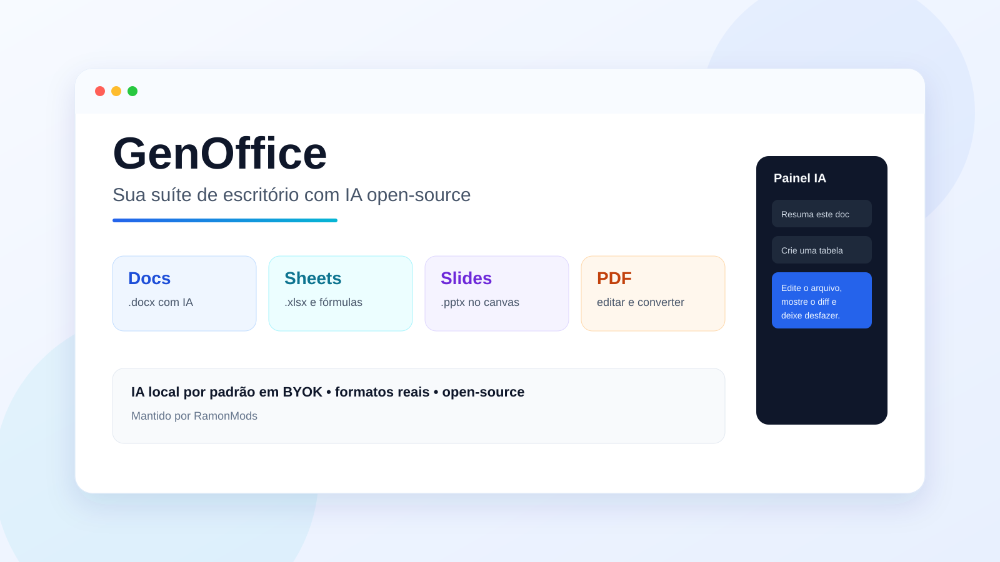

<p align="center">
  <a href="https://github.com/RamonMods/GenOffice">
    <picture>
      <source srcset="docs/assets/readme/hero-dark.svg" media="(prefers-color-scheme: dark)">
      
    </picture>
  </a>
</p>

<h1 align="center">GenOffice</h1>

<p align="center"><b>A primeira suíte de escritório com IA open-source e completa.</b><br>
Arquivos Word, Excel, PowerPoint e PDF, editados por você e pela sua IA, salvos de volta nos formatos reais.</p>

<p align="center">
  <a href="LICENSE"></a>
  <a href="https://github.com/RamonMods/GenOffice/releases/latest"></a>
  <a href="https://github.com/RamonMods/GenOffice/releases"></a>
  <a href="https://github.com/RamonMods/GenOffice/stargazers"></a>
  <br><br>
  <a href="https://pixgg.com/ramon"></a>
</p>

<p align="center">
  <a href="#download"><b>Download</b></a> ·
  <a href="#recursos"><b>Recursos</b></a> ·
  <a href="#linha-de-comando-e-skill-de-agente"><b>CLI</b></a> ·
  <a href="#servidor-mcp"><b>MCP</b></a> ·
  <a href="#privacidade"><b>Privacidade</b></a> ·
  <a href="CONTRIBUTING.md"><b>Contribuir</b></a>
</p>

GenOffice é uma alternativa gratuita e open-source ao Microsoft Office para macOS, Windows e Linux. Abre e salva arquivos nativos `.docx`, `.xlsx` e `.pptx`, edita PDF, Markdown e HTML, e coloca um agente de IA ao lado de cada documento — não um chat preso na lateral, mas um editor que lê o arquivo, faz a alteração e mostra exatamente o que tocou.

- **Formatos reais, preservação de bytes.** Só o que você edita é reescrito. Todo o resto do arquivo sobrevive byte a byte, para que os documentos continuem funcionando no Word, Excel e PowerPoint.
- **IA que você pode revisar.** Edições chegam como alterações rastreadas e diffs com rollback em um clique. Planilhas recebem fórmulas vivas, não números colados. Apresentações e páginas são geradas no canvas e permanecem totalmente editáveis.
- **Local por design.** Arquivos abrem, editam, salvam e convertem na sua máquina. PDF → Word / Excel / PowerPoint, Markdown → Word e HTML → Word rodam localmente. Só as chamadas de IA saem da máquina, para o provedor que você escolher.
- **Busque arquivos pelo que eles dizem.** A tela inicial pesquisa nomes, pastas e texto completo dos seus arquivos `.docx`, `.xlsx`, `.pptx`, PDF, Markdown e HTML a partir de um índice SQLite local, incluindo CJK.
- **Suas chaves ou nenhuma.** Entre com RamonMods e pule chaves, ou traga sua própria chave para Claude, OpenAI, Gemini, DeepSeek, Kimi, GLM, Qwen, Doubao, MiniMax, Grok, Mistral, OpenRouter e qualquer endpoint compatível com OpenAI, inclusive servidores locais.
- **Scriptável e pronto para agentes.** O app inclui a CLI `genoffice` e uma skill para Claude Code, Codex, Cursor, Gemini CLI, GitHub Copilot, OpenCode e Windsurf, para que um agente de código possa criar, converter, ler e editar arquivos Office reais na sua máquina sem abrir janela.

## Download

**Baixe agora:** [macOS](https://github.com/RamonMods/GenOffice/releases/latest) (Apple Silicon e Intel) · [Windows](https://github.com/RamonMods/GenOffice/releases/latest) (x64 e Arm) · [Linux](https://github.com/RamonMods/GenOffice/releases/latest) (deb, rpm, AppImage).

| Plataforma | Requisitos | Arquivo |
|---|---|---|
| **macOS** — Apple Silicon (arm64) | macOS 11+ | [`.dmg` mais recente (arm64)](https://github.com/RamonMods/GenOffice/releases/latest) |
| **macOS** — Intel (x64) | macOS 11+ | [`.dmg` mais recente (x64)](https://github.com/RamonMods/GenOffice/releases/latest) |
| **Windows** (x64) | Windows 10+, Intel/AMD | [Instalador `-x64.exe` mais recente](https://github.com/RamonMods/GenOffice/releases/latest) |
| **Windows** on Arm (ARM64) | Windows 11 on Arm | [Instalador `-arm64.exe` mais recente](https://github.com/RamonMods/GenOffice/releases/latest) |
| **Linux** — Debian / Ubuntu | x86_64, glibc 2.34+ | [`.deb` mais recente](https://github.com/RamonMods/GenOffice/releases/latest) |
| **Linux** — Fedora / RHEL / openSUSE | x86_64, glibc 2.34+ | [`.rpm` mais recente](https://github.com/RamonMods/GenOffice/releases/latest) |
| **Linux** — outras distros | x86_64, glibc 2.34+, FUSE 2 | [`.AppImage` mais recente](https://github.com/RamonMods/GenOffice/releases/latest) |

Versões anteriores estão na [página de Releases](https://github.com/RamonMods/GenOffice/releases).

## Recursos

### Docs — edite `.docx` com IA revisável
Abre o arquivo como o Word organiza: seções em duas colunas, imagens, tabelas sombreadas, cabeçalhos e rodapés, paginação nas métricas de linha do Word. Estilos, comentários, alterações rastreadas, equações, tinta e controles de conteúdo fazem round-trip sem tocar no que não foi editado.

### Sheets — `.xlsx` com fórmulas vivas e gráficos
O agente cria planilhas com `SUMIF`s reais, gráficos e alterações em lote desfazíveis. Perguntas sobre a pasta de trabalho voltam com o raciocínio e as células exatas usadas como citações clicáveis.

### Slides — de um prompt a um deck `.pptx`
Gere apresentações no canvas, edite totalmente e exporte como `.pptx` real.

### PDF, Markdown e HTML
Edite PDF, Markdown e HTML com o mesmo painel de IA. Conversões locais: PDF → Word/Excel/PowerPoint, Markdown → Word, HTML → Word.

## Linha de comando e skill de agente

O app inclui a CLI `genoffice` para criar, converter, ler e editar arquivos Office reais na sua máquina.

```bash
genoffice --help
```

## Servidor MCP

GenOffice também expõe ferramentas via MCP para agentes compatíveis.

## Privacidade

Arquivos abrem, editam, salvam e convertem localmente. Apenas chamadas de IA saem da máquina, para o provedor que você escolher. Veja [PRIVACY.md](PRIVACY.md).

## Contribuindo

Contribuições são bem-vindas. Veja [CONTRIBUTING.md](CONTRIBUTING.md).

## Segurança

Para reportar vulnerabilidades, veja [SECURITY.md](SECURITY.md).

## Licença

[Apache-2.0](LICENSE). GenOffice é mantido por [RamonMods](https://github.com/RamonMods).

<p align="center">
  <a href="https://pixgg.com/ramon"></a>
</p>

